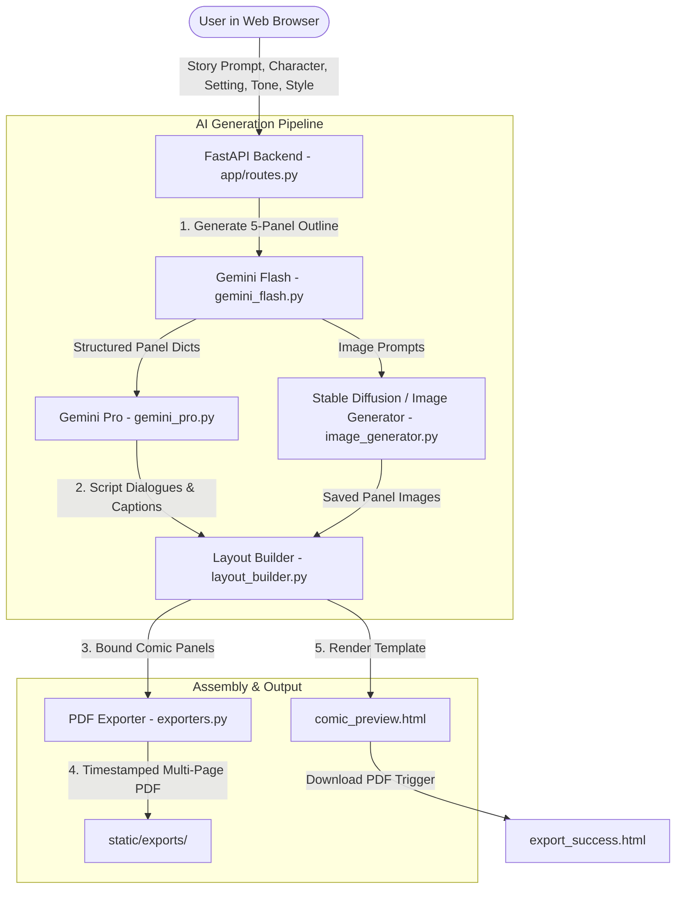

# ComicCraft - AI Comic Story Creator using Gemini Models

ComicCraft is a full-featured web application that leverages Google’s Gemini Large Language Models and Stable Diffusion / generative AI imaging to automatically generate personalized, 5-panel comic book stories and illustrations from user prompts.

Built with **FastAPI**, **Jinja2**, and **FPDF2**, ComicCraft transforms simple story premises into fully realized comic strips—complete with panel-by-panel outlines, atmospheric scene descriptions, character dialogues, vivid illustrations, and printable multi-page PDF exports.

---

## 🌟 Key Highlights & Scenarios Supported

- **Scenario 1 (Creative Immersion)**: Enter a story premise like *"A brave fox exploring an enchanted forest"*, select the protagonist's name, setting (*Forest*), tone (*Dramatic*), and art style (*Comic Book* or *Anime*). The pipeline generates a coherent 5-panel comic strip with images, captions, and speech bubbles.
- **Scenario 2 (Iterative Customization)**: Adjust tone (e.g. switch to *Funny*) and art style (e.g. *Pixel Art* or *Classic Comic Book*) to regenerate a fresh narrative arc with tailored jokes and visual style.
- **Scenario 3 (Professional PDF Export)**: Preview your comic panel-by-panel on the web interface, click **"Download Your Comic as PDF"** to trigger instantaneous compilation of an A4 multi-page comic book via `FPDF2`, and get seamlessly transitioned to the **Export Success** page with direct offline sharing and options to create another story.

---

## 🏗️ Architecture & Component Flow



### Modular Components:
1. **`app/gemini_flash.py`**: Calls Google Gemini Flash to generate a structured 5-panel comic outline with panel titles, visual descriptions, and text-to-image prompts.
2. **`app/gemini_pro.py`**: Calls Google Gemini Pro to expand the outline into dramatic narrative captions and character dialogues.
3. **`app/image_generator.py`**: Generates high-quality comic illustrations matching the requested art style (Comic Book, Anime, Pixel Art, Watercolor, Noir), saving them safely to `static/panels/`.
4. **`app/layout_builder.py`**: Assembles image paths, scene descriptions, and dialogue blocks into an ordered layout list.
5. **`app/exporters.py`**: Uses `fpdf2` to produce an illustrated PDF with custom cover page, panel frames, speech bubbles, and metadata.
6. **`app/routes.py`**: Provides endpoints for web form generation, JSON API access, image testing, and PDF file downloads.

---

## 🚀 Quick Start Guide

### 1. Prerequisites
- Python 3.10+
- (Optional) Google Gemini API Key from [Google AI Studio](https://aistudio.google.com/)

### 2. Installation
Navigate to the project root and install dependencies:

```bash
cd d:\cattle\comiccraft
pip install -r requirements.txt
```

### 3. Environment Configuration
Create or update your `.env` file:

```env
GEMINI_API_KEY=your_gemini_api_key_here
HF_API_KEY=your_huggingface_api_key_here
HOST=127.0.0.1
PORT=8000
```
*(Note: If no API key is provided, ComicCraft's built-in creative narrative and illustration engine automatically powers the comic creation so you can test end-to-end immediately without any blockers).*

### 4. Run the Server
Launch ComicCraft with hot reload enabled:

```bash
uvicorn app.main:app --reload --host 127.0.0.1 --port 8000
```

- **Web Application**: Open [http://127.0.0.1:8000](http://127.0.0.1:8000)
- **Interactive Swagger Docs**: Open [http://127.0.0.1:8000/docs](http://127.0.0.1:8000/docs)

---

## 📡 API Endpoints Reference

| Method | Endpoint | Description |
|---|---|---|
| `GET` | `/` | Loads ComicCraft homepage (`index.html`) |
| `POST` | `/generate` | Submits HTML form and renders comic preview (`comic_preview.html`) |
| `POST` | `/generate-comic/json` | REST API endpoint accepting `PromptRequest` JSON, returns layout & PDF URL |
| `GET` | `/export-success` | Displays the confirmation page after comic download |
| `GET/POST`| `/test-image` | Quick utility endpoint to test single panel image generation |
| `GET` | `/download-pdf/{filename}` | Direct attachment download endpoint for generated comic PDFs |
| `GET` | `/api/health` | System health check and API configuration verification |

---

## 🎨 UI/UX Design System (White Theme)
- **High Contrast & Readability**: Built with a clean white canvas (`#FFFFFF` / `#F8FAFC`) and deep charcoal typography (`#0F172A`) ensuring WCAG AAA compliant contrast.
- **Comic Accents**: Vibrant purple (`#7C3AED`), rose (`#EC4899`), and comic paper yellow (`#FEF08A`) narrative boxes.
- **Interactive Micro-actions**: Live multi-step progress bar during AI generation, preset prompt chips for instant creative sparks, and responsive mobile-first panels.
